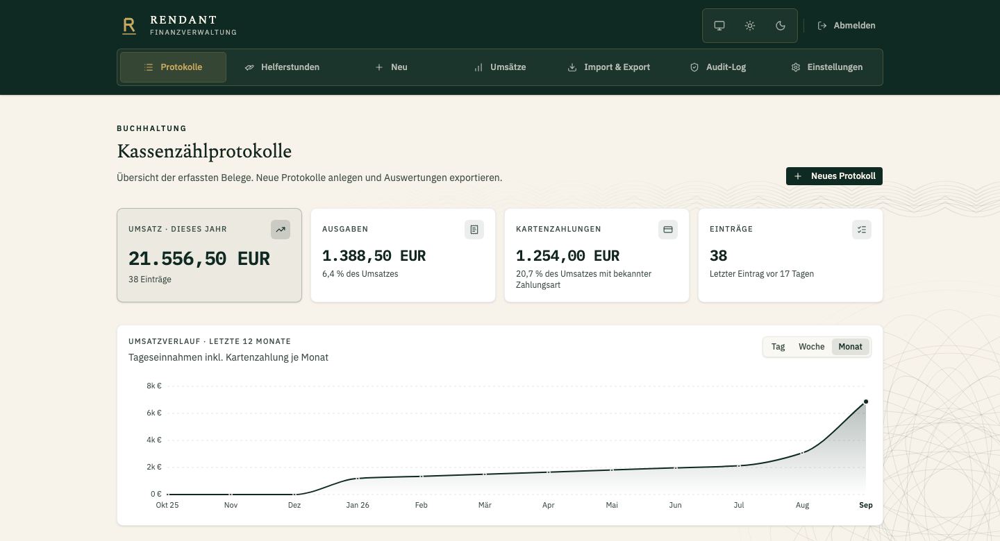

# Rendant

Rendant ist eine Finanzverwaltung für Vereine. Die Anwendung erfasst Kassenbewegungen, erstellt nummerierte PDF-Belege und wertet Umsätze und Umsatzsteuer aus. Historische Daten können aus Excel übernommen und Ergebnisse als PDF oder CSV für die Buchhaltung ausgegeben werden.

Jeder Verein hat einen eigenen Arbeitsbereich. Rendant unterstützt Kassen, Veranstaltungen, Belege und Korrekturen sowie einen rollenbasierten MCP-Zugang. Mehr zu den [Funktionen](docs/funktionen.md) und zur [Vereinsverwaltung](docs/multi-tenancy.md).



Gebaut mit Bun, TanStack Start, React und PostgreSQL. Der produktive Betrieb läuft auf Vertex RKE2 mit Fleet und Garage-Objektspeicher.

## Lokale Entwicklung

Voraussetzungen:

- Bun
- PostgreSQL
- Für den vollständigen PDF-Ablauf ein S3-kompatibler Bucket

Einrichtung:

```bash
bun install --frozen-lockfile
cp .env.example .env
```

Mindestens `DATABASE_URL`, `BETTER_AUTH_SECRET`, `BETTER_AUTH_URL`,
`ADMIN_EMAIL` und `ADMIN_PASSWORD` in `.env` setzen. Für PDF-Speicherung und
das Herunterladen zusätzlich die S3-Variablen konfigurieren. Danach:

```bash
bun run db:migrate:prod
bun run dev
```

Die Anwendung läuft unter <http://localhost:3000>. Der Migrator wendet alle
offenen Drizzle-Migrationen an, legt die globalen Einstellungen an und erzeugt
den initialen Admin idempotent aus den `ADMIN_*`-Variablen.

## Prüfungen

```sh
bun run check
bun run test
bun run test:integration
bun run build
```

Für eine isolierte Browser-Testinstanz mit Docker zunächst `SANDBOX_ADMIN_PASSWORD` setzen und dann `bun run sandbox` starten. Das Passwort muss mindestens zwölf Zeichen lang sein. `bun run sandbox:down` entfernt verbliebene Sandbox-Container. Konfiguration und weitere Werte stehen in [`.env.example`](.env.example).

## Betrieb

CI veröffentlicht das Image in GHCR, Fleet übernimmt den geprüften Digest. Ein Init-Container führt Datenbankmigrationen aus; `/api/health` prüft die Bereitschaft. Hinweise zur Wiederherstellung stehen in [Backup und Restore](docs/backup-restore.md).

Der MCP-Endpunkt `/api/mcp` verwendet vereinsbezogene Tokens. Rechte und Integration sind in [Technische Vereinsverwaltung](docs/tenant-integrations.md) beschrieben.

## Lizenz

Proprietäre Software. Die Nutzung erfordert eine schriftliche Erlaubnis. Siehe [LICENSE](LICENSE).
